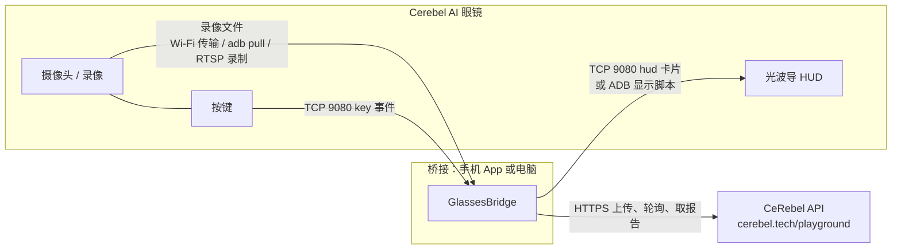

# Cerebel AI 眼镜接入

这篇讲怎么让 Cerebel AI 眼镜用上 CeRebel 的动作分析：眼镜拍一段动作，几分钟后镜片上出现"一条要改的地方"和一句动作提示。

眼镜的固件、真机脚本和硬件资料在私有仓库 [`Gary-Lin08/cerebel-ar-glasses`](https://github.com/Gary-Lin08/cerebel-ar-glasses)，这里只讲两边怎么对接。

## 先说结论：计算不在眼镜上

| | 眼镜（量产参数） | 分析流水线需要 |
|---|---|---|
| 芯片 | Rockchip RV1106B，单核 Cortex-A7，NPU 约 0.5 TOPS | GEM-X 人体重建要 NVIDIA GPU（线上用 Modal 的 GPU） |
| 内存 | 128 MB | GEM-X 模型常驻显存；OpenSim IK 单个任务要几百 MB |
| 系统 | 轻量 Linux（uClibc），没有 Python | Python 3.10 + PyTorch + OpenSim |
| 显示 | 640×480 单色绿光波导，单眼 | — |
| 电池 | 180–320 mAh | 一次分析几分钟的满负荷计算 |

所以分工是：

- **眼镜**：拍摄、显示、按键、麦克风和扬声器。这和眼镜仓库自己定下的原则一致："眼镜端保持轻量，AI 推理、排版、TTS 和长期日志放在手机、电脑或后端。"
- **桥接程序**（手机 App 或电脑）：从眼镜拿到录像，调用 CeRebel API 上传、等结果，把结论排成 HUD 卡片发回眼镜。
- **CeRebel 服务端**：和网页版完全相同，不需要为眼镜改。



## 第一人称的问题：戴眼镜的人拍不到自己

动作分析要看到**全身**。戴在头上的摄像头拍不到佩戴者自己的髋、膝、脚，所以"自己戴着眼镜拍自己挥杆"目前做不了。实际可行的用法：

| 用法 | 谁戴眼镜 | 谁拍 | 现状 |
|---|---|---|---|
| **A. 教练模式** | 教练 | 眼镜拍学员（侧面、全身入镜、2–4 米） | 可以用。眼镜仓库里的实时教练（`kinetic-lens/live/`）就是这个用法 |
| **B. 显示模式** | 练习者 | 手机或相机放在三脚架上拍；眼镜只负责显示结果和接收按键 | 可以用，画质和帧率最好，推荐 |
| C. 自拍第一人称 | 练习者 | 眼镜拍自己 | 不支持。需要从第一人称画面估计全身姿态，属于研究方向 |

用法 A 拍的是别人：被拍的人也要知道视频会被上传分析。CeRebel 的视频处理同意只覆盖账号持有人自己上传的视频，给别人拍之前，请先确认法务上怎么取得对方同意（美国的生物特征数据法规对此有要求）。

## 30 秒试一下（不需要真机）

在三个终端里分别运行。先装 SDK：

```bash
pip install -e sdk/python
```

终端 1，模拟的 CeRebel API：

```bash
cerebel mock api --port 8099
```

终端 2，模拟的眼镜（打印收到的 HUD 卡片）：

```bash
cerebel mock glasses --port 19080
```

终端 3，先建一个测试账号并同意视频处理（只对模拟服务器操作）：

```bash
python -c "from cerebel import CerebelClient as C; c=C('http://127.0.0.1:8099'); c.register('coach@example.com','password123',accept_terms=True); c.accept_video_consent(); print(c.token)"
```

再把输出的令牌填进下面的命令，分析一个文件（模拟服务器不看文件内容，大于 1 KB 就行）：

```bash
cerebel --base-url http://127.0.0.1:8099 --token <令牌> glasses bridge --clip swing.mp4 --glasses 127.0.0.1:19080
```

终端 2 会依次显示：`收到录像` → `准备视频` → …… → `要改 66° → 0° | Your back knee locks too early. Keep a soft back knee to the top`。

## 9080 链路协议

眼镜是服务端（监听 TCP 9080），手机或电脑主动连上去。iOS 伴侣 App（眼镜仓库 `nega-ios/`）和它的模拟眼镜已经按这个协议实现；SDK 的 Python 和 TypeScript 实现与之兼容。

**帧格式**：4 字节大端无符号长度 + 该长度的 UTF-8 JSON。一帧一个对象，必须有 `type`。单帧上限 1 MB。收到不认识的 `type` 要忽略，方便协议以后扩展。

| 方向 | type | 字段 | 说明 |
|---|---|---|---|
| 眼镜 → 主机 | `hello` | `fw`、`battery` | 连上后眼镜先发 |
| 眼镜 → 主机 | `key` | `action`：`photo`、`rec_start`、`rec_stop` | 按键 |
| 眼镜 → 主机 | `pcm` | `seq`、`sr`（16000）、`ch`（1）、`data_b64` | 麦克风音频 |
| 主机 → 眼镜 | `hud` | `mode`：`info`、`assist`、`fact`、`end`；`status` ≤ 40 字、`reply` ≤ 160 字、`you` ≤ 80 字 | 显示一张卡片 |
| 主机 → 眼镜 | `ping` | — | 主机每 8 秒发一次保活 |

```text
00 00 00 2a  {"type":"hud","mode":"info","status":"排队中 22%"}
└─ 长度 ─┘   └──────────────── UTF-8 JSON ────────────────┘
```

代码：Python `sdk/python/cerebel/glasses/protocol.py`、`link.py`；TypeScript `sdk/typescript/src/glasses.ts`（不绑定具体 socket，React Native 或 Node 都能用）。

**安全**：这条链路目前是局域网明文、没有认证，同一个 Wi-Fi 里任何设备都能连上眼镜发 HUD、听麦克风。在开放网络里用之前，需要加配对令牌（例如 `hello` 之后主机发 `{"type":"auth","token":…}`，眼镜校验后才处理其他消息）和 TLS。这是设备端的工作，记在下面的待办里。

## 录像怎么到桥接程序

眼镜本机录像存在 `/userdata/Rec/factory_*.h264`，是**没有封装的 H.264 裸流**。API 只收 MP4/MOV 等封装格式，所以需要先封装。SDK 的 `prepare_clip()` 会自动处理（需要 ffmpeg）：

```python
from cerebel.glasses import prepare_clip
mp4 = prepare_clip("factory_20260815_122121.h264", fps=30)
```

把文件从眼镜拿到桥接设备，现有三种方式：

| 方式 | 做法 | 适合 |
|---|---|---|
| ADB | `adb pull /userdata/Rec/<文件> <监听目录>/`，桥接程序用 `--watch <监听目录>` 自动处理 | 开发、教练在电脑旁 |
| Wi-Fi 传到手机 | 眼镜仓库的甘特图里标为已完成，手机 App 收到文件后调用 SDK | 正式产品 |
| RTSP 录制 | 眼镜开 `rkipc` 推流（子码流 `rtsp://<眼镜IP>:8554/live/1`），桥接端用 ffmpeg 录一段 | 不想在眼镜上写盘时 |

**帧率是最容易踩的坑**：服务端拒绝低于 24 fps 的视频。真机实测（眼镜仓库 `CURRENT_DEVICE_SNAPSHOT.md`，2026-08-15）：

- 传感器约 30 Hz。本机写 eMMC 时，前 15 秒左右接近 30 fps，之后掉到约 25 fps。
- 请求 20 / 24 fps 会被抽成 15 fps，**15 fps 会被服务端拒绝**。
- 所以：用 30 fps 录，每段控制在 15 秒以内（一次挥杆 3–5 秒足够）。
- 裸流没有时间信息，`prepare_clip(fps=…)` 要填实际保存的帧率；录像时生成的时间戳 CSV 可以算出实际帧率。填错会让动作变快或变慢，关节角速度会跟着错。

**方向**：传感器是 640×480 横向安装，`rkipc` 默认旋转 270°。上传前确认人是正着站的，横着的先转正（会重新编码）：

```bash
ffmpeg -i clip.mp4 -vf transpose=2 upright.mp4
```

**构图**：全身入镜，侧面拍（正对挥杆方向的侧面），2–4 米。拍摄要求和手机上传相同：1.5–30 秒，短边 ≥ 320 像素。

## HUD 怎么设计

显示屏是 640×480、4 位灰度的绿色单色光波导，在一只眼睛前面。一张卡片要一眼看完：

| 时机 | mode | status（上方小字） | reply（主体） |
|---|---|---|---|
| 收到录像 | `info` | 收到录像 | |
| 排队 | `info` | 排队中 22% | 前面 1 个 · ~3 min |
| 重建 / 计算 | `info` | 重建身体 45% | |
| 完成 | `assist` | 要改 66° → 0° | Your back knee locks too early. Keep a soft back knee to the top |
| 没识别到挥杆 | `end` | 分析失败 | 没识别到完整挥杆，请从侧面重拍一次 |
| 没同意视频处理 | `end` | 分析失败 | 请先在手机上同意视频处理条款 |
| 本月次数用完 | `end` | 分析失败 | 本月免费分析次数已用完 |

规则：

- 只显示**一条**修正（`findings` 里第一条非优点项），配一句动作时的感觉提示（`cue`）。练习方法（`drill`）、原因（`why`）留给手机或语音。
- 进度卡片同一阶段内最多 15 秒更新一次，换阶段时立即更新，避免频繁刷屏耗电。
- 现有的实时教练渲染器一行大约 24 个字，`reply` 超过时由眼镜端换行或滚动。
- 结论文案（`headline`、`cue`）目前只有英文，由服务端生成；状态行已经有中文和英文。要做中文结论，需要在服务端 `sport_analysis.py` 加多语言文案，不要在桥接端用模型翻译（数字和术语可能被改）。

这些卡片在 `cerebel.glasses.hud`（Python）和 `glasses.fixCard()` / `progressCard()`（TypeScript）里，两边输出一致。

## 接真机的两种显示方式

1. **9080 链路**（眼镜运行 9080 服务时）：

    ```bash
    cerebel glasses bridge --watch ./recordings --glasses 192.168.1.50:9080
    ```

2. **ADB 显示脚本**（现在就能用）：眼镜仓库的 `adb/show_text.ps1` 等脚本通过 ADB 把文字推到显示服务。`CommandHudSink` 会为每张卡片运行一次你指定的命令，`{text}` 被替换为卡片文字。命令以参数列表传入，不经过 shell，文字里的特殊字符不会被当成命令执行：

    ```bash
    cerebel glasses bridge --watch ./recordings --hud-command powershell -NoProfile -File adb\show_text.ps1 -Text "{text}"
    ```

    `--hud-command` 必须放在最后。

用 Python 写自己的桥接：

```python
from cerebel import CerebelClient
from cerebel.glasses import GlassesBridge, GlassesLink, LinkHudSink

client = CerebelClient(token=load_token_from_keychain(), upload_base_url=UPLOAD_ORIGIN)
with GlassesLink("192.168.1.50", 9080, on_key=lambda a: print("key", a)) as link:
    bridge = GlassesBridge(client, LinkHudSink(link), lang="zh", fps=30)
    bridge.watch("./recordings")          # 或 bridge.process_clip("take1.h264")
```

手机 App（React Native / 网页）用 TypeScript SDK：

```ts
import { CerebelClient, glasses } from "@cerebel/sdk";

const client = new CerebelClient({ token, uploadBaseUrl: UPLOAD_ORIGIN });
const result = await client.analyze(videoBlob, {
  onProgress: (p) => socket.write(glasses.encodeFrame(glasses.progressCard(p, "zh"))),
});
socket.write(glasses.encodeFrame(glasses.fixCard(result.main_fix, "zh")));
```

原生 iOS App 可以从 `sdk/openapi.yaml` 生成 Swift 客户端；眼镜链路已经在 `nega-ios/NEGA/Services/GlassesTCPClient.swift` 里实现。

## 账号、同意和令牌

- 眼镜没有地方展示长篇的同意文本，所以**注册和视频处理同意必须在手机 App 或网页上完成**。桥接程序遇到 `ConsentRequired`（428）只在 HUD 上提示去手机上处理，不能替用户自动同意。
- 登录令牌只放在桥接设备上：手机放钥匙串，电脑放 `~/.config/cerebel/credentials.json`（`cerebel login` 会把权限设成 600）。**不要把令牌写进眼镜固件或眼镜的文件系统。**
- 视频和结果属于登录的账号。教练用自己的账号给多名学员分析时，所有记录都在教练的作品库里；要按学员分开，目前需要每位学员自己的账号。

## 待办

| 项目 | 在哪做 | 说明 |
|---|---|---|
| 眼镜端 9080 服务 | 眼镜仓库 | iOS App 和模拟眼镜已按协议实现；真机端先确认是否已部署 |
| 9080 链路的配对和加密 | 眼镜仓库 + SDK | 见上面"安全" |
| 录像传输消息 | 协议 | 提案：眼镜录完发 `{"type":"clip","name":"factory_…h264","bytes":…,"fps":29.8,"url":"http://<眼镜IP>/rec/…"}`，主机按 URL 拉取。设备端未实现，SDK 暂用文件夹监听 |
| 中文结论文案 | 服务端 `sport_analysis.py` | 见"HUD 怎么设计" |
| 实时提示 | 眼镜仓库 `kinetic-lens/live/` | 那里是电脑端 MediaPipe 实时数次数和提示，和本文的事后精细分析是两条线，可以并存 |
| 第一人称全身估计 | 研究 | 解决"自己戴着拍自己" |
| 眼镜 NPU 上的姿态估计 | 眼镜仓库 | 眼镜仓库的记录显示当前固件的 NPU 驱动没有注册设备（`/dev/rknpu` 不存在），要先解决内核和设备树问题 |
