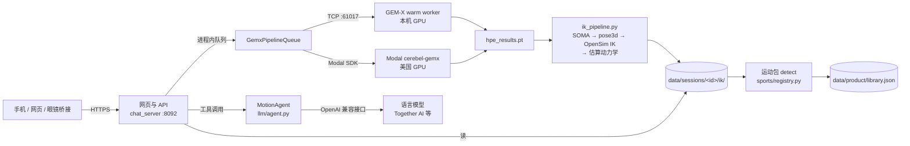

# 系统架构

## 一句话

手机视频 → GEM-X 在 GPU 上重建 3D 人体（SOMA 骨架）→ 重定向到 OpenSim Rajagopal 肌骨模型做逆运动学 → 得到关节角度和估算负荷 → 运动包（Sport Pack）识别运动、分阶段、找出最该改的一个动作 → AI 教练调用确定性工具回答追问。

没有数据库。账号、令牌、作品库、计费、埋点都是 `data/product/` 下的 JSON / JSONL 文件，用跨进程文件锁（`motion_agent/app/file_lock.py`）保护；每个会话是 `data/sessions/<id>/` 下的一个目录。见[数据格式](data-formats.md)。

## 进程和端口

| 进程 | 入口 | 默认端口 | 线上是否运行 | 作用 |
|---|---|---|---|---|
| 网页与 API | `python -m motion_agent.app.chat_server` | 8092（只绑本机，经 HTTPS 隧道对外） | 是 | 登录、上传、报告、教练、计费、条款页。上传队列也在这个进程里 |
| 操作员界面 | 同一进程，设 `CEREBEL_OPERATOR_PORT` 后另开 | 8093（只绑 127.0.0.1） | 是 | `?dev=1` 的 Playground、提示词编辑、运营统计，经 SSH 隧道访问 |
| GEM-X warm worker | `gemx_warm_worker.py` | 61017（本机） | 用本机 GPU 时 | 模型常驻显存，一行一个 JSON 请求。用 Modal 时不需要 |
| Modal 函数 | `deploy/modal_gemx.py` | — | 是（`CEREBEL_GPU_BACKEND=modal`） | 同样的 GEM-X 推理，按秒计费，限定美国机房 |
| 数据保留任务 | `python -m motion_agent.app.retention` | — | 每天一次 | 按隐私政策删原始视频、不活跃账号等 |
| iOS 采集（旧） | `server.py`（gRPC，`capture.proto`） | 61016 | 否 | 早期 iOS App 推流 JPEG 帧用。**没有认证和加密**，不要暴露到公网 |
| 独立上传服务（旧） | `upload_server.py` | 8093 | 否（作为库被 chat_server 导入） | 早期独立上传页；现在只用它的队列和流水线函数 |
| 旧网页 API | `web_api.py` | 本机 | 否 | 第一版网页后端，已被 chat_server 取代 |
| 3D 预览 / Kinetic Lens | `mesh_viewer_service.py`、`kinetic_lens_viewer.py` | 8090 / 8091（本机） | 否 | 内部查看器 |

注意 8093 同时是 `CEREBEL_OPERATOR_PORT` 的推荐值和旧 `upload_server.py` 的默认端口，两者不要同时启动。

## 一段视频的旅程

以网页上传为例（`motion_agent/app/product_api.py` → `upload_server.py` → `gemx_pipeline.py` → `ik_pipeline.py`）：

| 步骤 | 代码 | 进度阶段（`upload_progress.json` 的 `stage`） |
|---|---|---|
| 1. 检查登录、月度额度、视频处理同意。任何一项不满足都直接拒绝，不写盘 | `save_upload` | — |
| 2. 保存到 `upload/source_video.*`，用 ffprobe 质检：1.5–30 秒、≥24 fps、短边 ≥320 px。不合格立刻删除视频，返回 422，不计次 | `save_upload`、`quality_check` | `uploading` |
| 3. 如果前端传了裁剪窗口，只保留那一段 | `trim_video` | |
| 4. 后台线程开始处理；网页请求立即返回 `session_id` | `_run_pipeline` | `extracting` |
| 5. 按原帧率抽 JPEG 帧（高于 60 fps 的按 30 fps 抽）、写 `header.json`，进入 GPU 队列。本机 GPU 一次一个任务，Modal 默认 10 个并行 | `_process_uploaded_session`、`GemxPipelineQueue` | `queued` |
| 6. GEM-X 推理，输出 `hpe_results.pt`（SOMA 人体参数）。GPU 不可用时任务以 `gpu_unavailable` 失败 | `run_gemx_warm` / `run_gemx_modal` | `gemx` |
| 7. SOMA → `pose3d.json` → 颈部感知的 OpenSim IK（Rajagopal 2023 + 颈部）→ `opensim-motion.json` → 估算地面反力和关节力矩 → `estimated-dynamics.json`；生成 `ik/session.mp4` | `run_ik_pipeline` | `ik` |
| 8. 精简 `hpe_results.pt`：删掉网络中间输出，把头部形状系数清零（重建出的头是平均头型） | `hpe_privacy.py` | |
| 9. 写进度 `ready`（这时还没识别运动） | `_on_pipeline_complete` | `ready` |
| 10. 运动包识别：高尔夫检测器打分；识别不到就记为 `no_swing`，不计次。然后把识别结果写回进度和作品库，发"分析完成"邮件 | `finalize_capture` | `ready`（带 `sport`）或 `no_swing` |

整个过程超过 45 分钟会以 `timeout` 失败。客户端判断完成时要注意第 9、10 步之间的窗口：**`ready` 且带 `sport` 字段才算最终完成**（SDK 已经处理）。

### 当前的建模假设

- **所有人按同一个身材建模**：IK 用固定的 185 cm / 93 kg（`CEREBEL_SUBJECT_HEIGHT_CM`、`CEREBEL_SUBJECT_MASS_KG`）。关节角度受影响不大，估算负荷的绝对值会偏。
- **单目、未标定**：没有标记点、没有测力台。地面反力是从质心加速度和视频里的脚着地情况估算的，所有负荷都标注为"估算"，置信度上限约 61%（见 `kinetic-lens/docs/visualization-contract.md`）。
- 手臂细节模型 MoBL-ARMS 只允许非商业使用，线上关闭（`CEREBEL_MOBL_ARMS=0`）。

## 报告怎么来的

- `GET /api/sport_analysis` → `motion_agent/motion/sport_analysis.py`：从 OpenSim 坐标算出几条关键曲线（后膝弯曲、肩髋分离、骨盆漂移等），按规则生成 `findings`，**按严重程度排序**，第一条非 `strength` 的就是产品主推的那条修正。每条 finding 带标题、测量值、原因、感觉提示（cue）、练习（drill）、下次怎么检查。
- `GET /api/golf_phases` → `motion/golf_phases.py`：找出视频里有几次挥杆，每次分成准备、起杆、上杆、顶点、下杆、击球、收杆七个阶段。
- `GET /api/compare` → `app/compare.py` + `motion/swing_compare.py`：同一账号两次挥杆按阶段对齐比较。每个指标有一个暂定的噪声阈值（`margin`），变化在阈值内就判"没有明显变化"。

## AI 教练

`motion_agent/llm/agent.py` 的 `MotionAgent`：

1. 根据会话的运动选择提示词模式（golf、general 等，`llm/prompts.py`），消费者端会被限制在该会话支持的模式。
2. 高尔夫模式先自动调用 `segment_golf_swings` 和 `build_sport_analysis`，把结果放进上下文。
3. 进入工具循环：模型通过 OpenAI 兼容的 function calling 调用 `motion_agent/tools/` 里的工具（关节轨迹、质心、着地、动力学、知识库检索等，完整列表见[扩展指南](extending.md#给-ai-教练加一个工具)），直到给出最终回答。`MOTION_AGENT_MAX_TOOL_CALLS` 限制单个问题的成本。
4. 默认**不把视频帧发给模型**（`CEREBEL_LLM_ATTACH_VIDEO=0`）：既不附带视频，也不向模型提供取画面的工具（`get_rgb_frame`、`get_rgb_clip`），模型只看到问题和工具算出的数字。
5. 每天的提问次数有上限：匿名 3 次、免费 15 次、Pro 100 次；匿名访客另有每天 300 次的总上限。

## 代码地图

| 路径 | 内容 |
|---|---|
| `motion_agent/app/` | 网页服务：`chat_server.py`（路由）、`product_api.py`（上传、作品库、权限）、`accounts.py`、`billing.py`（Stripe，只用标准库）、`consent.py`、`retention.py`、`media_urls.py`（签名的媒体链接）、`compare.py`、`notify.py`（邮件） |
| `motion_agent/app/ui/` | 前端静态文件，不需要构建。`index.html` 同时包含消费者界面和操作员界面 |
| `motion_agent/motion/` | 动作计算：`sequence.py`（读 OpenSim 结果）、`angles.py`、`kinematics.py`、`events.py`、`golf_phases.py`、`sport_analysis.py`、`swing_compare.py` |
| `motion_agent/dynamics/` | 估算动力学的读取和换算（力矩、功率、地面反力） |
| `motion_agent/tools/` | 给 AI 教练调用的工具 |
| `motion_agent/llm/` | 智能体循环、提示词、工具 schema、OpenAI 兼容客户端 |
| `motion_agent/sports/` | 运动包：注册表、高尔夫、通用人体、棒球（未开放）、即将推出的运动 |
| `motion_agent/knowledge/` | 本地知识库（RAG）：`corpus/<运动>/` 下的 txt 文件和检索工具 |
| `motion_agent/mesh/`、`rendering/` | 3D 片段导出、图表和力的可视化 |
| `motion_agent/storage/` | 找会话目录、读视频文件、缓存 |
| `motion_agent/tests/` | 服务端测试（unittest） |
| `gemx_pipeline.py`、`gemx_warm_worker.py`、`upload_server.py` | GPU 队列和流水线 |
| `ik_pipeline.py`、`smpl_to_pose3d.py`、`run_opensim_ik_cerebel.py`、`cerebel_ik_retarget.py` | SOMA → OpenSim |
| `hpe_privacy.py` | 精简 GEM-X 输出，清零头部形状系数 |
| `kinetic-lens/` | React/Three.js 3D 查看器、OpenSim 模型和几何、颈部重定向（`retargeting_neck_v2/`） |
| `deploy/` | 部署脚本：`us/`（DigitalOcean）、`mac/`（Mac mini）、`modal_gemx.py`、`supervisor/`、`gemx_overlay/`（对 GEM-X 上游的本地修改） |
| `sdk/` | Python 和 TypeScript SDK、OpenAPI 规范 |
| `capture.proto`、`server.py` | 旧的 iOS gRPC 采集链路 |
| `webapp/`、`upload_ui/` | 早期原型页面，线上不用 |
